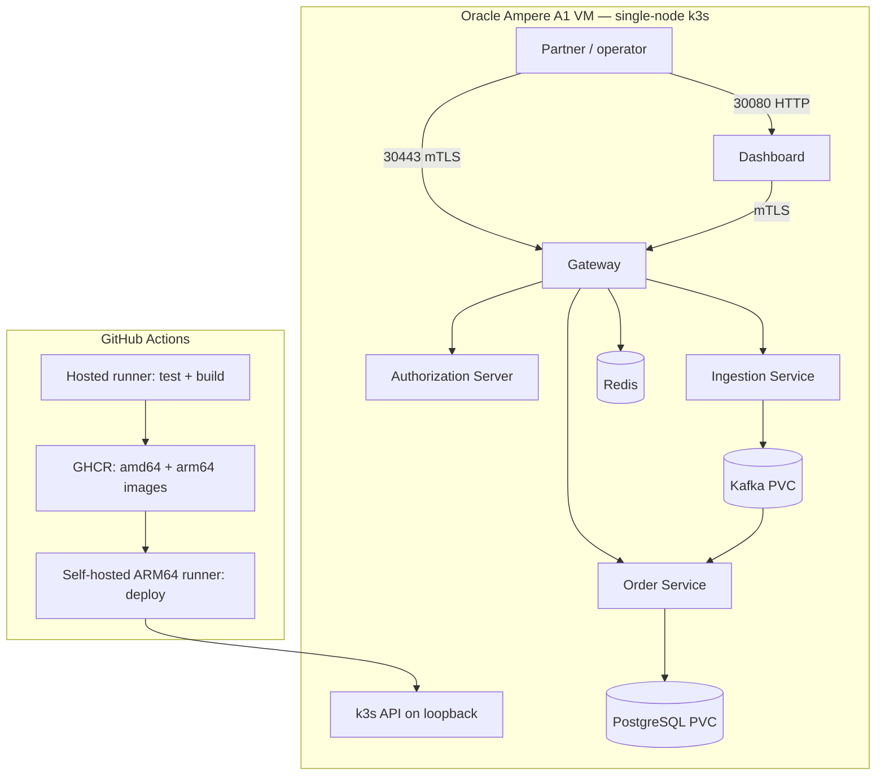

# EDIFlow k3s deployment

This runbook deploys EDIFlow to one Oracle Cloud Ampere A1 VM. It deliberately uses a GitHub Actions self-hosted runner on that VM: GitHub-hosted runners build and publish multi-architecture images, while the local runner performs only `kubectl` deployment. The Kubernetes API on port `6443` therefore stays private.

## Topology



Only TCP `22`, `30080`, and `30443` need Oracle Network Security List/NSG ingress. Do not expose PostgreSQL, Kafka, Redis, the internal services, or Kubernetes port `6443` publicly. Restrict SSH to your own IP.

This is intentionally a single-node portfolio deployment, not a highly available production design. PostgreSQL and Kafka use k3s local-path persistent volumes; a VM or availability-domain failure still causes downtime.

## Resource budget

| Workload | CPU request | Memory request | Limit |
|---|---:|---:|---:|
| PostgreSQL | 150m | 256Mi | 750m / 1Gi |
| Kafka | 250m | 512Mi | 1 CPU / 2Gi |
| Redis | 50m | 64Mi | 250m / 256Mi |
| Authorization Server | 100m | 192Mi | 500m / 512Mi |
| Ingestion Service | 150m | 256Mi | 750m / 768Mi |
| Order Service | 200m | 384Mi | 1 CPU / 1Gi |
| Gateway | 100m | 256Mi | 750m / 768Mi |
| Dashboard | 25m | 64Mi | 200m / 192Mi |
| **Total requested** | **1.025 CPU** | **1.984Gi** | — |

These requests leave headroom for k3s, image builds elsewhere, the OS, and load spikes on a 4 OCPU/24 GB A1 instance. Adjust them from observed use.

## 1. Prepare the VM

Use Ubuntu 24.04 ARM64 or Oracle Linux 9 ARM64. Point a DNS record such as `ediflow.example.com` to the VM's reserved public IP before generating certificates.

```bash
git clone https://github.com/vaibhav7506/EDIFlow.git
cd EDIFlow
sudo bash scripts/install-k3s.sh
sudo k3s kubectl get nodes
```

The bootstrap script installs the stable k3s channel, disables unused Traefik, and waits for the node to become Ready. k3s writes its kubeconfig to `/etc/rancher/k3s/k3s.yaml`.

## 2. Install the GitHub Actions runner

In GitHub, open **Settings → Actions → Runners → New self-hosted runner**, select Linux and ARM64, and run GitHub's generated commands as a dedicated unprivileged user. Add the custom label `ediflow`, then install it as a service:

```bash
sudo ./svc.sh install
sudo ./svc.sh start
sudo ./svc.sh status
```

Do not install the runner as root. The workflow supplies a short-lived copy of kubeconfig from an encrypted repository secret, so the runner user does not need permanent access to `/etc/rancher/k3s/k3s.yaml`.

## 3. Generate deployment certificates

On a trusted workstation with JDK 21 and OpenSSL, create a separate ignored certificate directory. The public DNS name must appear in the Gateway certificate SAN:

```powershell
.\scripts\generate-certs.ps1 -OutputDirectory .deployment-certs -GatewayPublicSan "dns:ediflow.example.com" -Password "use-a-long-random-password"
```

Use `ip:203.0.113.10` instead only when clients connect by a stable public IP. Keep the CA private key and all client private keys off the VM except for the dashboard key required by its Kubernetes Secret.

## 4. Configure GitHub

Create a protected GitHub environment named `production`. Add the repository/environment variable:

| Variable | Example |
|---|---|
| `PUBLIC_GATEWAY_URL` | `https://ediflow.example.com:30443` |

Add these encrypted secrets:

| Secret | Source / purpose |
|---|---|
| `KUBE_CONFIG_B64` | Base64 of `/etc/rancher/k3s/k3s.yaml`; because the runner is on the VM, its loopback server URL is correct |
| `GHCR_USERNAME` | GitHub user that can read the image packages |
| `GHCR_PULL_TOKEN` | Fine-grained/classic token with package read access |
| `POSTGRES_PASSWORD` | Random database password |
| `B2B_CLIENT_SECRET` | Partner OAuth client secret |
| `READER_CLIENT_SECRET` | Read-only OAuth client secret |
| `ADMIN_CLIENT_SECRET` | Administrator OAuth client secret |
| `GRAFANA_ADMIN_PASSWORD` | Grafana administrator password |
| `TLS_STORE_PASSWORD` | Password used when generating the PKCS#12 files |
| `GATEWAY_P12_B64` | Base64 of `gateway.p12` |
| `TRUSTSTORE_P12_B64` | Base64 of `truststore.p12` |
| `DASHBOARD_CLIENT_CERT_B64` | Base64 of `dashboard-client.crt.pem` |
| `DASHBOARD_CLIENT_KEY_B64` | Base64 of `dashboard-client.key.pem` |
| `PARTNER_CLIENT_P12_B64` | Base64 of `partner-client.p12`, used only by the post-deploy health check |
| `CA_CERT_B64` | Base64 of `ca.crt` |

Create one-line base64 values without copying binary data into the repository:

```bash
sudo base64 -w0 /etc/rancher/k3s/k3s.yaml
base64 -w0 .deployment-certs/gateway.p12
```

On PowerShell:

```powershell
[Convert]::ToBase64String([IO.File]::ReadAllBytes(".deployment-certs/gateway.p12"))
```

The workflow creates or updates Kubernetes Secrets directly. [`secret.example.yaml`](../infra/k8s/secret.example.yaml) documents their schema and is never included by Kustomize.

## 5. Deploy and verify

A push or merge to `main` now performs:

1. Java tests and all four Boot JAR builds.
2. Dashboard dependency install and production build.
3. Kustomize rendering validation.
4. Five `linux/amd64` + `linux/arm64` image builds and GHCR publication with immutable commit-SHA tags.
5. Secret reconciliation, `kubectl apply`, image update, and rollout waits on the VM.
6. A separate GitHub-hosted runner verifies the public mTLS health endpoint from outside the VM.

Manual inspection commands on the VM:

```bash
sudo k3s kubectl -n ediflow get pods,svc,pvc
sudo k3s kubectl -n ediflow get events --sort-by=.lastTimestamp
curl --cert-type P12 --cert 'partner-client.p12:STORE_PASSWORD' --cacert ca.crt https://ediflow.example.com:30443/actuator/health
```

Expected public endpoints:

- Dashboard: `http://ediflow.example.com:30080`
- Gateway: `https://ediflow.example.com:30443` (client certificate required)

## Rollback and operations

Application deployments retain ReplicaSet history, so roll back a failed release with:

```bash
sudo k3s kubectl -n ediflow rollout undo deployment/gateway
sudo k3s kubectl -n ediflow rollout status deployment/gateway --timeout=5m
```

Repeat for the affected deployment. Database migrations are forward-only Flyway migrations; rolling an image back does not reverse a schema migration. Back up PostgreSQL and the certificate material before changes:

```bash
sudo k3s kubectl -n ediflow exec postgres-0 -- pg_dump -U ediflow ediflow > ediflow-backup.sql
```

Useful diagnostics:

```bash
sudo k3s kubectl -n ediflow describe pod POD_NAME
sudo k3s kubectl -n ediflow logs deployment/order-service --tail=200
sudo k3s kubectl -n ediflow top pods
```

`kubectl top` requires Metrics Server; k3s normally installs it by default. Keep GHCR packages private only if the `GHCR_PULL_TOKEN` is maintained and rotated; public packages can be pulled anonymously, though the workflow still creates the pull secret consistently.
