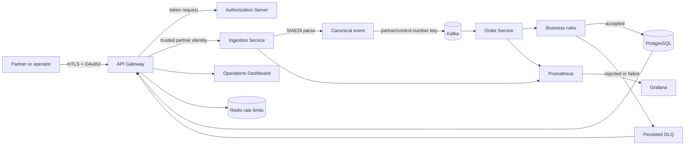
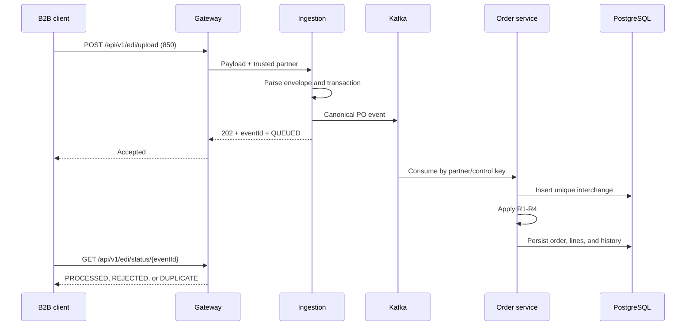
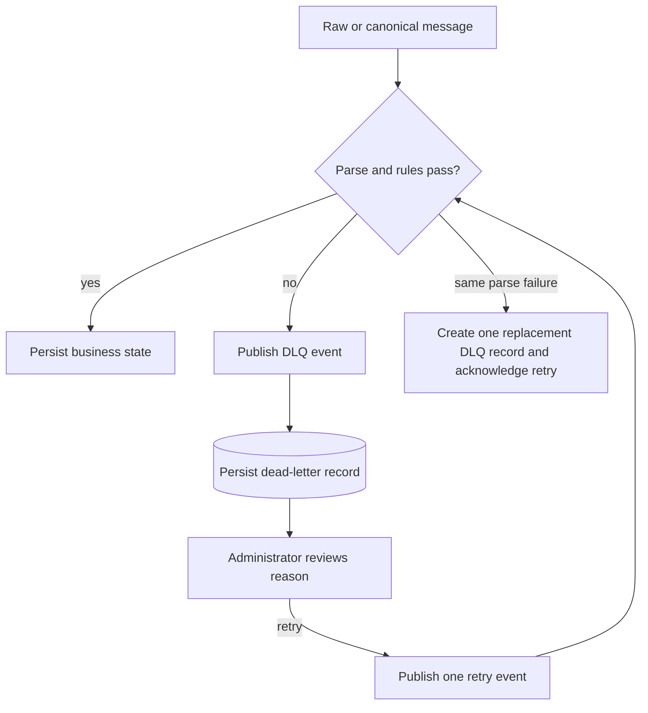

# EDIFlow application and workflow

EDIFlow turns partner-supplied ANSI X12 documents into trusted, queryable order and invoice state. It exists to make B2B document exchange secure, asynchronous, idempotent, explainable, and operable instead of treating EDI as a file-upload parsing exercise.

## What the application does

- Accepts ANSI X12 850 purchase orders and 810 invoices.
- Authenticates the connecting system with mTLS and authorizes actions with OAuth2 scopes.
- Parses ISA-defined delimiters with StAEDI and emits a canonical event.
- Uses Kafka to decouple ingestion from order processing.
- Applies deterministic partner, line, reference, and amount rules.
- Prevents duplicate interchanges under concurrent delivery.
- Persists orders, invoices, state history, event status, partners, and dead letters.
- Gives operators a dashboard for upload, search, approval, audit, and retry.
- Exposes metrics for ingestion, errors, lag, latency, duplicates, and DLQ depth.

## System flow

## Request and security flow

1. A system presents a certificate signed by the EDIFlow CA. The TLS handshake fails without it.
2. The client requests a token with its OAuth client ID, secret, and scopes.
3. The Gateway validates the JWT and checks `edi:read`, `edi:write`, or `admin` for the route.
4. Redis applies a distributed limit keyed by OAuth client ID.
5. The Gateway removes untrusted identity headers and forwards the authenticated partner identity.

This layered model is necessary because possession of a network certificate should not automatically grant every business operation, and a bearer token should not be usable from an untrusted machine.

## Purchase-order flow (X12 850)

The service treats `CTT01` as the declared PO1 line count. It calculates monetary totals from quantity multiplied by unit price and does not interpret `CTT02` as money.

## Invoice flow (X12 810)

1. Ingestion publishes a canonical invoice event.
2. The order service verifies that the referenced PO exists for the same partner.
3. It compares the invoice total with the persisted PO total.
4. A match becomes `PERSISTED`; a difference becomes `MATCH_EXCEPTION` with audit history.

This flow makes reconciliation a business decision with evidence, not an implicit database write.

## Duplicate flow

The database unique key is `(partner_id, isa_control_number, st_control_number)`. If two consumers race, only one can insert the interchange. The other records `DUPLICATE`, and no second order is created. Database enforcement is necessary because a read-before-write check is not safe under concurrency.

## Failure and retry flow

A retry does not silently mutate the payload. It is an auditable new attempt. A still-malformed raw document produces one replacement DLQ record; it is not multiplied by the Kafka listener's automatic retry policy.

## Why this workflow is necessary

- **Reliability:** Kafka absorbs bursts and isolates temporary downstream failures.
- **Correctness:** database constraints stop concurrent duplicates.
- **Security:** partner identity comes from authenticated credentials, not document claims or headers.
- **Auditability:** every business transition has a timestamp and reason.
- **Recovery:** failures remain visible and retryable instead of disappearing into logs.
- **Operations:** lag and latency expose a pipeline that is alive but unhealthy.

## How EDIFlow is different

EDIFlow is an open, code-first reference implementation focused on the mechanics that integration engineers need to inspect: parser behavior, event contracts, transaction boundaries, security filters, rules, SQL constraints, retry semantics, tests, and metrics all live in one repository. It intentionally favors deterministic rules and transparent infrastructure over vendor-managed maps and networks.

It is not yet a commercial replacement for mature EDI networks. It currently supports two X12 document types, one primary order/invoice workflow, and a self-operated deployment. Its differentiator is inspectability and a narrow end-to-end implementation, not breadth of standards or a pre-connected trading-partner network.

## Current competitor landscape

The comparison below reflects vendor-published capabilities reviewed on 31 August 2026.

| Product | What the vendor currently emphasizes | Difference from EDIFlow |
|---|---|---|
| [IBM Sterling B2B Integration Suite](https://www.ibm.com/products/b2b-integration-suite) | Major EDI standards, any-to-any transformation, partner onboarding, monitoring, managed file transfer, and hybrid deployment | Far broader protocol, transformation, and enterprise HA coverage; EDIFlow is smaller, open, and easier to inspect end to end |
| [SPS Commerce Fulfillment](https://www.spscommerce.com/products/fulfillment/warehouse-services/) | Retail fulfillment, pre-connected partner workflows, inventory/shipping automation, API and traditional EDI | Strong retail network and managed compliance; EDIFlow provides the middleware implementation rather than a commercial partner network |
| [Cleo Integration Cloud](https://www.cleo.com/cleo-integration-cloud) | EDI/API/MFT orchestration, no-code onboarding, any-to-any transformation, AI-assisted exception handling, ERP/WMS/TMS connectivity | More connectors, mapping tools, and managed-service options; EDIFlow uses explicit Java rules and infrastructure that teams fully control |
| [TrueCommerce EDI](https://www.truecommerce.com/products/edi-software/) | Managed EDI, ERP integration, supplier portals, partner onboarding, support, and a large network | Optimized for outsourced operational outcomes; EDIFlow is a self-hosted engineering platform without a pre-connected network |
| [Boomi B2B/EDI Management](https://boomi.com/platform/b2b-management/) | Cloud-native B2B/EDI, no-code workflows, multiple standards and protocols, monitoring, ERP/CRM connectivity, and AI agents | Broader iPaaS and low-code capabilities; EDIFlow keeps event processing, security, and audit behavior explicit in source code |

## Deployment flow

- Docker Compose provides the complete local system.
- GitHub Actions runs tests, builds multi-architecture images, and publishes them to GHCR.
- A self-hosted ARM64 runner applies k3s manifests and waits for every rollout.
- An external runner verifies the public Gateway with a real client certificate.
- Vercel can host the static dashboard assets. It cannot replace the long-running JVM consumers, Kafka, PostgreSQL, Redis, volumes, or client-certificate Gateway. A production Vercel dashboard needs a public k3s Gateway plus a server-side mTLS proxy; private keys must never be embedded in the Vite bundle.

For the rationale behind these boundaries, see [architecture decisions](decisions.md). For commands and rollback procedures, see [the deployment runbook](deployment.md).
